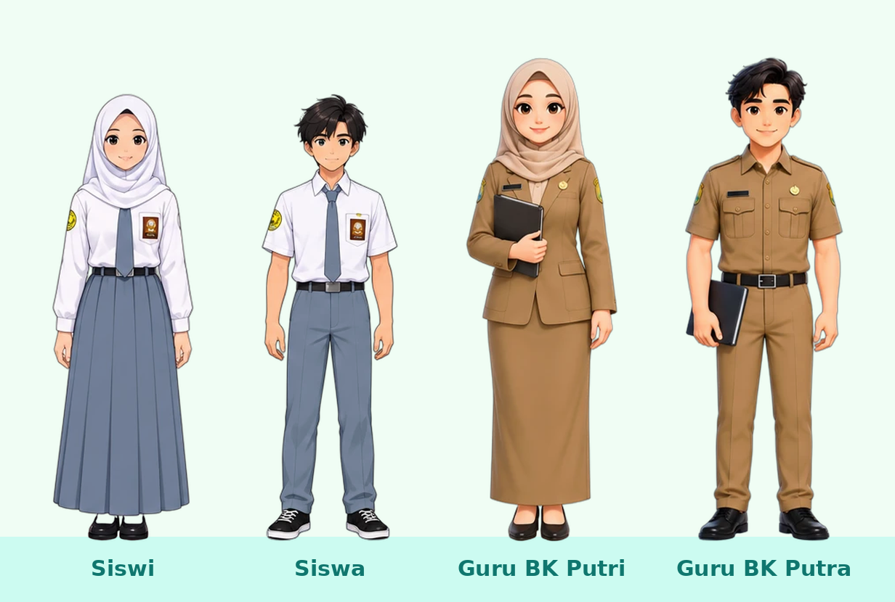
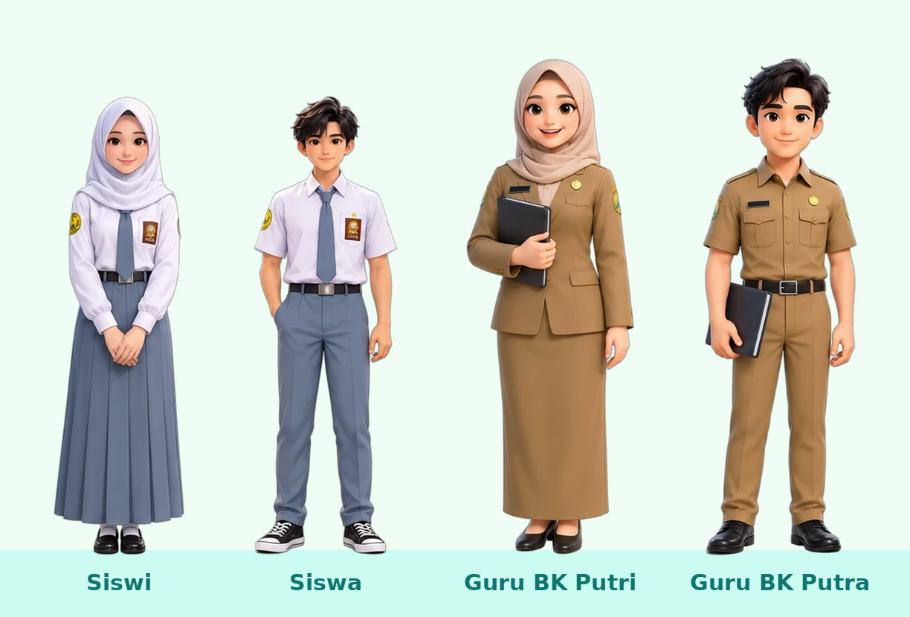
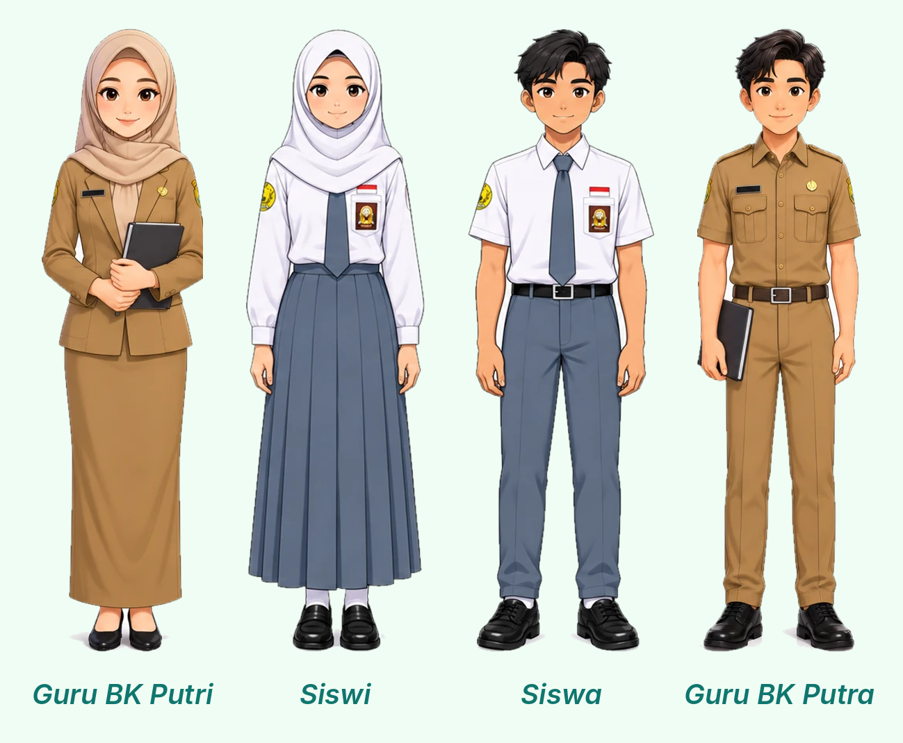

# Identitas Visual Instagram @bksmanrici

Acuan wajib untuk semua desain konten Instagram BK SMAN 1 Cigalontang.
Sumber: `Panduan_Identitas_Digital_IG_bksmanrici.pdf` (folder ini).

## Aset

| File | Keterangan |
|---|---|
| `logo-bk-smanrici.png` | Logo BK bulat, latar transparan (800×800), dibuat dari `logo-bk-smanrici-sumber.jpg` dengan `potong_logo.py`. Dipasang di header setiap slide, ukuran ±68 px pada kanvas 1080 px |
| `font/PlusJakartaSans-latin.woff2` | Font judul (Plus Jakarta Sans, variable 200–800, lisensi SIL OFL) |
| `Panduan_Identitas_Digital_IG_bksmanrici.pdf` | Panduan asli |

## Palet Warna

| Nama | Hex | Makna | Pemakaian |
|---|---|---|---|
| **Toska Utama** | `#0D9488` | Kepercayaan & ketenangan | Warna dominan: latar cover/poster, ring highlight, aksen judul |
| Toska tua | `#0F766E` | — | Gradien latar toska, bayangan |
| **Hijau Zamrud** | `#10B981` | Pertumbuhan & dinamis | Garis bawah judul, ikon sekunder, penanda sukses |
| **Emas Hangat** | `#F59E0B` | Humanis & prestasi | Tombol CTA, sorotan, nomor poin |
| Emas tua / muda | `#D97706` / `#FEF3C7` | — | Angka di lingkaran nomor / latar lingkaran nomor & kotak catatan |
| Tinta | `#0F172A` | — | Judul di latar terang |
| Teks | `#1E293B` / abu `#475569` | — | Isi & keterangan |
| Latar terang | `#FFFFFF`, `#F8FAFC`, mint `#F0FDF4` | — | Latar slide isi / infografik |
| Latar gelap | `#0F172A` → `#1E293B` | — | Khusus kerangka **Pengumuman Kegiatan** |

## Tipografi

- **Judul:** Plus Jakarta Sans, ExtraBold (800), huruf rapat (letter-spacing negatif tipis)
- **Isi:** Inter, Regular/SemiBold
- **Label kecil (eyebrow):** Inter Bold, huruf kapital, letter-spacing lebar, warna toska/zamrud

## Kerangka Desain

1. **Sampul Sorotan (Highlight):** latar putih bersih, ring toska, ikon berwarna mencolok (emas/zamrud). Kategori: *Tips BK* (bohlam), *Informasi* (megafon), *Kegiatan* (orang).
2. **Poster Layanan:** latar toska, ikon dalam lingkaran putih, judul besar putih, subjudul singkat, **tombol CTA pil emas** (mis. "Booking Sesi Sekarang"). Nuansa ruang aman, hangat, dan ramah.
3. **Infografik Edukasi:** kartu putih bersudut membulat, judul + garis zamrud pendek, poin bernomor di **lingkaran tint lembut** (emas/toska/mint). Visual bersih, hindari paragraf bertumpuk.
4. **Pengumuman Kegiatan:** latar slate gelap, foto kegiatan nyata, gradien toska di bawah, eyebrow emas, judul acara paling dominan, ikon kalender + tanggal.

## Aturan Praktis

- Ukuran feed/carousel **1080×1350** (4:5); Reels/Stories **1080×1920**.
- Header: logo + "BK SMANRICI"; kanan: nomor slide atau rubrik (#SeninStarter, #RabuRuangAman, #JumatNgobrolBK).
- Maksimal 3 warna brand per slide + netral; emas untuk satu titik fokus saja (CTA/sorotan).
- Ilustrasi gaya flat, karakter beragam (berjilbab & tidak, warna kulit beragam), seragam putih abu.
- Contoh penerapan: `../desain/tka-5-hal-carousel.html`.

## Karakter 2D (standar baru)

Set karakter 2D ini (dan set 3D di bawahnya) **menggantikan** set lama untuk konten baru.
Lembar referensi ada di `karakter/2d/referensi/`, semua PNG transparan dibuat oleh `karakter/2d/potong_2d.py` (BiRefNet lewat `rembg`); gambar jajaran oleh `karakter/2d/buat_lineup.py`.

| Karakter | Folder | Ciri |
|---|---|---|
| Siswi | `karakter/2d/siswi/` | Jilbab putih panjang, kemeja putih lengan panjang, dasi abu, rok abu lipit panjang, badge OSIS, emblem SMA kuning di lengan, sepatu pantofel hitam, kaos kaki putih |
| Siswa | `karakter/2d/siswa/` | Rambut hitam pendek, kemeja putih lengan pendek, dasi abu, celana abu, badge OSIS, emblem SMA, sepatu kets hitam |
| Guru BK Putri | `karakter/2d/guru-bk-putri/` | Hijab krem, blazer & rok panjang khaki (seragam dinas), papan nama, emblem di kedua lengan, sepatu hak hitam |
| Guru BK Putra | `karakter/2d/guru-bk-putra/` | Rambut hitam bergelombang, kemeja dinas khaki lengan pendek, celana khaki, papan nama, emblem lengan, sepatu pantofel hitam |

Palet seragam siswa (dari lembar): putih `#FFFFFF`, abu muda `#CBD5E1`, abu `#64748B`, biru dongker `#1E3A5F`. Warna tidak diubah, karakter tetap ditaruh di atas palet brand.

**Isi tiap folder:**

| File | Isi |
|---|---|
| `tampak-depan.png`, `tampak-belakang.png` | Badan penuh |
| `menghadap-kanan.png`, `menghadap-kiri.png` | Badan penuh, wajah/badan ke arah itu |
| `utama.png` | Pose utama besar (siswi & siswa saja) |
| `pose-*.png` | Siswi: salam, memegang-buku, menunjuk, semangat, peace, membawa-tas, membawa-tablet, mempresentasikan. Siswa: melambaikan-tangan, mengacungkan-jempol, menyilangkan-tangan, menunjuk, memegang-buku, memakai-tas, berjalan, sikap-santai. Siswa/siswi badan penuh; guru setengah badan (menyapa, memberi-arahan, menjelaskan, diskusi-konseling, lalu putri: berpikir, memegang-dokumen, memegang-tablet; putra: mencari-solusi, tegas-profesional, memegang-dokumen) |
| `ekspresi-*.png` | Potret kepala-bahu. Siswi/siswa: normal, senang, tertawa, serius, terkejut, sedih, marah, malu. Guru: normal-ramah, senyum-terbuka, tertawa-senang, terkejut, serius-profesional, berpikir, lalu putri: sedih-empati, tertegun-mendengar; putra: empati, tegas |

Aturan pakai:
- Skala seragam saja; guru diperbesar ±1,08× saat berdiri bersama siswa.
- Pose guru dan semua ekspresi terpotong di bawah (setengah badan/potret): letakkan menempel tepi bawah kartu atau di dalam bingkai, jangan "melayang".
- Pilih ekspresi sesuai emosi naskah (mis. cemas → `sedih`/`terkejut`, lega → `senang`), dan guru `sedih-empati`/`empati` untuk adegan mendengarkan.
- Adegan konseling: guru `menghadap-kiri` di kanan, siswa `menghadap-kanan` di kiri.
- Wajah karakter ini ilustrasi, bukan siswa sungguhan, jadi aman dipakai tanpa izin wajah.

Menambah atau memperbaiki potongan: ubah kotak di `LEMBAR` pada `potong_2d.py`, lalu `pip install "rembg[cpu]"` dan `python3 potong_2d.py` (±30 detik per potongan di CPU), kemudian `python3 buat_lineup.py`.

## Karakter 3D

Karakternya sama dengan set 2D (siswi, siswa, guru BK putri & putra, seragam yang sama), tetapi bergaya render 3D yang lembut. Lembar referensi ada di `karakter/3d/referensi/`, dan PNG transparan dibuat oleh `karakter/3d/potong_3d.py` dengan pemotong yang sama seperti set 2D. Jajaran dibuat dengan `python3 karakter/2d/buat_lineup.py karakter/3d`.

Palet dari lembar guru (berlaku juga untuk kulit siswa):

| Bagian | Warna |
|---|---|
| Kulit | `#FAD7C0` |
| Hijab guru putri | `#E6D1C1` |
| Seragam dinas khaki | `#B0895B` |
| Rambut/alis guru putri | `#3A2F2A` |
| Rambut guru putra | `#2B2B2B` |
| Sepatu | `#1F1F1F` |
| Aksen (pin, emblem) | `#D4AF37` |

**Isi tiap folder** (`karakter/3d/<karakter>/`):

| File | Siswi | Siswa | Guru BK Putri | Guru BK Putra |
|---|---|---|---|---|
| `utama.png` | ✓ (bertas) | ✓ (bertas) | – | – |
| `tampak-depan`, `menghadap-kanan`, `menghadap-kiri`, `tampak-belakang` | ✓ | ✓ | ✓ | ✓ + `tiga-perempat-depan` |
| `pose-*.png` (badan penuh siswa, ¾ badan guru) | salam, memegang-buku, menunjuk, semangat, membawa-tas, mempresentasikan, berjalan | melambaikan-tangan, mengacungkan-jempol, menyilangkan-tangan, menunjuk, memegang-buku, memakai-tas, berjalan | menyapa, memberi-arahan, menjelaskan, diskusi-konseling (duduk di meja), berpikir, memegang-dokumen | menyapa, memberi-arahan, menjelaskan, diskusi-konseling (duduk), mencari-solusi, memegang-dokumen |
| `ekspresi-*.png` | normal, senang, tertawa, serius, terkejut, sedih, marah, malu | sama dengan siswi | normal-ramah, senyum-terbuka, tertawa-senang, terkejut, serius-profesional, berpikir, empati, tertegun-mendengar, sedih, tegas | normal-ramah, senyum-terbuka, tertawa-senang, terkejut, serius-profesional, berpikir, empati, tegas, ragu, semangat |

Kapan pakai 2D atau 3D:
- **Jangan campur 2D dan 3D dalam satu konten.** Pilih satu set per postingan atau per seri.
- 3D cocok untuk cover carousel, poster layanan, thumbnail Reels, dan pengumuman yang ingin terlihat lebih "premium". 2D lebih ringan untuk infografis padat teks dan animasi Reels sederhana.
- Aturan skala, potongan setengah badan, dan arah hadap sama dengan set 2D di atas.

## Karakter (set lama)

### Siswa

Lembar referensi: `karakter/referensi-karakter-siswa.webp` (siswa putra & putri SMANRICI, seragam putih abu: dasi abu, badge OSIS di saku, bendera merah putih, emblem kuning di lengan kiri, sepatu hitam, kaos kaki putih; siswi berjilbab putih panjang, kemeja lengan panjang, rok abu lipit panjang).

PNG transparan siap pakai (semua dibuat oleh `karakter/potong_karakter.py`):

| File | Pose |
|---|---|
| `siswa-putra-depan.png` | Putra, tampak depan |
| `siswa-putra-samping-kanan.png` / `-kiri.png` | Putra, menghadap kanan / kiri |
| `siswa-putri-depan.png` | Putri, tampak depan |
| `siswa-putri-samping-kanan.png` / `-kiri.png` | Putri, menghadap kanan / kiri |

Aturan pakai: jangan ubah proporsi (skala seragam saja), boleh dipotong jadi potret dalam lingkaran (lihat slide 3 carousel TKA), dan pakai karakter yang menghadap ke arah objek cerita (pintu BK, komputer, dsb.). Untuk pose lain (duduk, menunjuk, ekspresi berbeda), buat karakter baru dengan lembar referensi ini sebagai patokan agar wajah & seragam konsisten. Karakter putra tampak depan masih menyisakan sedikit putih di sela lengan, jadi taruh di latar terang.

### Guru BK

Lembar referensi: `karakter/referensi-karakter-guru.webp`, seragam dinas cokelat khaki dengan emblem di lengan dan papan nama di dada, sepatu hitam.
- **Guru BK Putri:** jilbab krem, blazer & rok panjang khaki, memegang map/buku.
- **Guru BK Putra:** kemeja lengan pendek & celana khaki, ikat pinggang cokelat, memegang map/buku (tampak depan), tangan di saku (tampak samping).

| File | Pose |
|---|---|
| `guru-bk-putri-depan.png` | Guru BK putri, tampak depan |
| `guru-bk-putri-samping-kanan.png` / `-kiri.png` | Guru BK putri, menghadap kanan / kiri |
| `guru-bk-putri-belakang.png` | Guru BK putri, tampak belakang |
| `guru-bk-putra-depan.png` | Guru BK putra, tampak depan |
| `guru-bk-putra-samping-kanan.png` / `-kiri.png` | Guru BK putra, menghadap kanan / kiri |
| `guru-bk-putra-belakang.png` | Guru BK putra, tampak belakang |

Saat tampil bersama siswa, perbesar guru ±1,08× agar terlihat lebih dewasa (di lembar referensi tingginya hampir sama).

Ide pemakaian: kartu penutup "Ruang BK terbuka" (guru menyambut siswa), poster layanan konseling, adegan konseling (guru & siswa saling berhadapan: guru `-samping-kiri` di kanan, siswa `-samping-kanan` di kiri), dan pengumuman kegiatan BK. Tampak belakang cocok untuk adegan berjalan menuju kelas/ruang BK.

Menambah lembar referensi baru: simpan gambarnya di `karakter/`, daftarkan kolom tiap pose di `LEMBAR` pada `potong_karakter.py`, lalu jalankan `python3 potong_karakter.py`.
